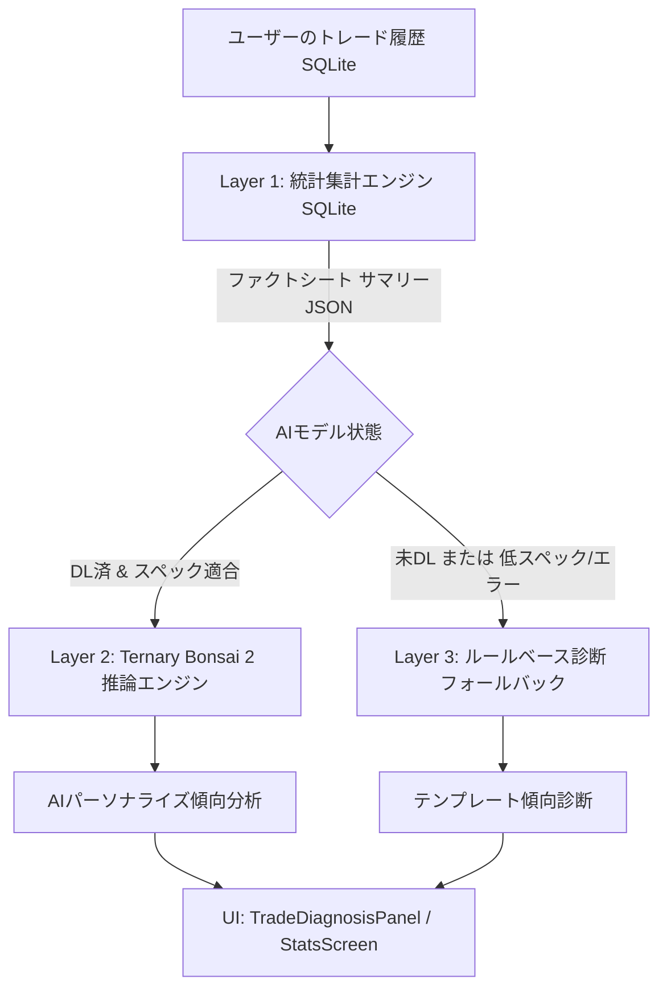

# On-Device AI 傾向分析機能 仕様書 (On-Device AI Analysis Spec)

## 1. 概要
本機能は、超軽量三値化ローカルLLM **「Ternary Bonsai 2 (2B)」**（約0.43GB / GGUF形式）をAppleの **On-Demand Resources (ODR)** およびGoogleの **Play Asset Delivery (PAD)** を活用して端末ローカルに動的配信し、ユーザーの過去のトレード入力履歴（損益、曜日、感情タグ、メモ等）から個人の投資傾向・癖をオフラインかつ完全なプライバシー保護のもとで分析・アドバイスする機能である。

---

## 2. システムアーキテクチャ (3層ハイブリッド方式)



### Layer 1: 統計集計エンジン (SQLite)
* トレードデータの全件（勝率、曜日別勝率、感情タグ別の平均損益、大勝翌日の勝率、連敗・連勝記録、取引時間帯）をSQLiteで厳密に計算。
* LLMの数値計算苦手（ハルシネーション）を防止するため、**数値計算は100%このレイヤーで完了させ、ファクトシートとしてJSON化**する。

### Layer 2: オンデバイス推論層 (Ternary Bonsai 2)
* ODR/PAD経由で取得した `bonsai-2-2b-ternary.gguf`（約430MB）をバックグラウンドスレッドでロード。
* Layer 1のファクトシートをプロンプトとして受け取り、自然言語でユーザーの癖や深層傾向、具体的な改善アクションを生成する。
* 推論完了後は、メモリ（RAM）を圧迫し続けないようコンテキストメモリを速やかに解放する。

### Layer 3: ルールベース診断 (フォールバック)
* モデル未ダウンロード時、非対応スペック端末、メモリ不足時、推論タイムアウト時には、既存の `LocalSqliteAnalysisService` に自動でフォールバックし、アプリが絶対に停止・クラッシュしない構造にする。

---

## 3. モデル配信設計 (直接ストリーミングダウンロード & ODR)

### 3.1 直接ストリーミングダウンロード (推奨・PoC/実機動作対応)
* **配信元URL**: `https://huggingface.co/prism-ml/Ternary-Bonsai-2-2B-gguf/resolve/main/Ternary-Bonsai-2-2B-PTQ1_0.gguf`
* **ファイル名**: `Ternary-Bonsai-2-2B-PTQ1_0.gguf`（実サイズ: 約0.43GB / 430MB）
* **保存先**: `getApplicationDocumentsDirectory() / ai_models / Ternary-Bonsai-2-2B-PTQ1_0.gguf`
* **動作仕様**:
  * `http.Client().send()` によるチャンク受信ストリーミング。
  * 受信バイト数を監視し、0.5%刻みでリアルタイムに進捗率（0.0〜1.0）をUIプログレスバーに通知。
  * ダウンロード中は一時ファイル（`.tmp`）に書き込み、完了時に正規ファイルへアトミックにリネーム。
  * 「モデルを削除」操作により、ストレージから安全にファイルを削除して容量を即時解放。

### 3.2 Apple On-Demand Resources (ODR / 本番App Store配布用)
* **アセットタグ名**: `on_device_ai_bonsai_2b`
* **容量**: 約430MB（ODRの1タグ上限512MB以内）
* **ホスティング費用**: **0円（Apple CDNが全額負担）**
* **ネイティブ実装**:
  * iOS側（Swift）で `NSBundleResourceRequest` を実装。
  * `MethodChannel` (`daytrack/on_device_ai_manager`) を介してFlutter側と通信：
    * `checkModelStatus()`: モデルが端末に存在するか確認
    * `downloadModel()`: ODRダウンロード開始（進捗割合 0.0〜1.0 を定期送信）
    * `cancelDownload()`: ダウンロード中断
    * `purgeModel()`: 端末からモデルキャッシュを削除（ストレージ解放）

### 3.2 Google Play Asset Delivery (PAD)
* **Asset Pack名**: `bonsai_model_pack` (delivery-mode: `on-demand`)
* **ホスティング費用**: **0円（Google Play CDNが負担）**
* **ネイティブ実装**:
  * Android側（Kotlin）で `AssetPackManager` を実装し、同様のMethodChannelでFlutterと連携。

---

## 4. 端末スペック判定とOOM（クラッシュ）防止

| 端末区分 | 判定基準 | 動作仕様 |
| :--- | :--- | :--- |
| **推奨端末** | RAM 6GB以上<br>(iPhone 15 Pro以降, M1/M2 iPad, Android RAM 6GB+) | 全機能フル稼働（コンテキスト長: 2048） |
| **制限付き許可** | RAM 4GB<br>(iPhone 11/12/13/14, SE第3世代, Android RAM 4GB) | 「ベータ版・メモリ負荷警告」を表示。<br>コンテキスト長を1024に制限し、軽量モードで実行 |
| **非対応端末** | RAM 3GB以下 | ダウンロードボタンを非活性化し、Layer 3（ルールベース）のみ提供 |

* **安全措置**:
  * UIメインスレッドとは分離した専用バックグラウンドIsolateで推論を実行。
  * 推論タイムアウト（30秒）を設け、万が一フリーズした場合は中断してLayer 3の診断を表示。
  * 推論終了後、直ちにモデルコンテキストを解放してRAMをOSに返却。

---

## 5. プロンプト設計 & 入出力仕様

### 入力ファクトシート（SQLiteから生成されるJSON例）
```json
{
  "total_trades": 128,
  "win_rate_percent": 54.2,
  "recent_90_days": {
    "trades": 42,
    "win_rate_percent": 47.6,
    "weekday_worst": {"day": "木曜日", "win_rate": 33.3, "avg_loss_yen": 12500},
    "emotion_risk": {"tag": "焦り", "trades": 8, "loss_rate": 87.5, "avg_loss_yen": 24000},
    "big_win_next_day": {"occurrences": 4, "next_day_loss_rate": 75.0},
    "max_drawdown_yen": 68000,
    "recent_loss_diaries": [
      {
        "date": "2026-10-18",
        "loss_yen": 15000,
        "tags": ["焦り", "リベンジ"],
        "memo": "寄り付きの急騰に飛びついて高値掴み。損切りできず後場でナンピンして撃沈。"
      }
    ],
    "recent_win_diaries": [
      {
        "date": "2026-10-17",
        "profit_yen": 22000,
        "tags": ["冷静", "順張り"],
        "memo": "前場で押し目をじっくり待ってエントリー。指値ルール通りに利確できた。"
      }
    ]
  }
}
```

### システムプロンプト
```text
あなたはトレード心理と行動経済学に精通した専属トレードコーチです。
提供されたトレード統計ファクトシートを客観的に分析し、ユーザーの「無意識の負けパターン」と「勝ちパターンを伸ばす行動指針」を温かくも的確に日本語で指摘してください。
特に直近の負けトレードや大勝トレードの日記・メモ内容から、思考の癖や心理的バイアス（飛びつき、ナンピン、過信、損切り遅れ等）を深く読み解き、具体的な行動ルールとしてアドバイスしてください。
計算済みの数値のみを参照し、数値を勝手に捏造しないでください。
```

### 出力構造 (`TradeDiagnosis` 拡張)
* `title`: 分析の要約見出し（例: 「木曜日のエントリー制限と『焦り』タグの克服が鍵」）
* `publicMessage`: ホーム画面で誰でも見られる総括（温かい励ましの一言）
* `privateMessage`: プレミアム/リワード広告アンロックで読めるAIの詳細な分析レポート（300〜500文字）
* `hasWarning`: 注意すべき負け癖が顕著な場合にtrue
* `isAiGenerated`: AIによる推論結果かどうかのフラグ

---

## 6. UI / UX 仕様 (Design System準拠)

### 6.1 設定画面 (`lib/presentation/setting_screen.dart`)
* セクション名: **「AI分析機能 (オンデバイス)」**
* **ダウンロード管理カード**:
  * モデル状態の表示: 「未ダウンロード」「ダウンロード中 (xx%)」「準備完了」
  * ストレージ容量表記: 「430MB（端末内オフライン動作）」
  * 「モデルをダウンロード」ボタン（Wi-Fi接続確認ダイアログ）
  * 「モデルを削除して容量を空ける」ボタン（ダウンロード済み時）
  * 端末スペック表示（例: 「お使いの端末: iPhone 15 Pro / 適合環境」）

### 6.2 ホーム画面診断パネル (`lib/presentation/widgets/trade_diagnosis_panel.dart`)
* AIモデルが準備完了している場合、ヘッダーに **`[AI分析]`** バッジを表示。
* 未ダウンロードの場合は従来の「ルールベース診断」を表示し、タップ時に設定画面への誘導リンクを表示。
* 推論中はローディングインジケーター（「AIがあなたのトレード傾向を分析中...」）を表示。

---

## 7. プライバシーポリシー & 利用規約の対応

* **プライバシーポリシー**:
  * 外部サーバーへのデータ送信は一切発生しないため、ポリシーの変更は**原則不要**。
  * ユーザーの安心感を高めるため、「オンデバイスAI機能において入力される取引データはすべて端末内で処理され、外部サーバーには一切送信されません」と設定画面やアプリ内ヘルプに明記する。
* **利用規約・免責事項**:
  * AIの分析結果は将来の利益を保証するものではなく、投資助言業務には該当しない旨の免責文言（「AIによる分析結果は参考情報であり、投資の最終判断は自己責任で行ってください」）を表示する。
